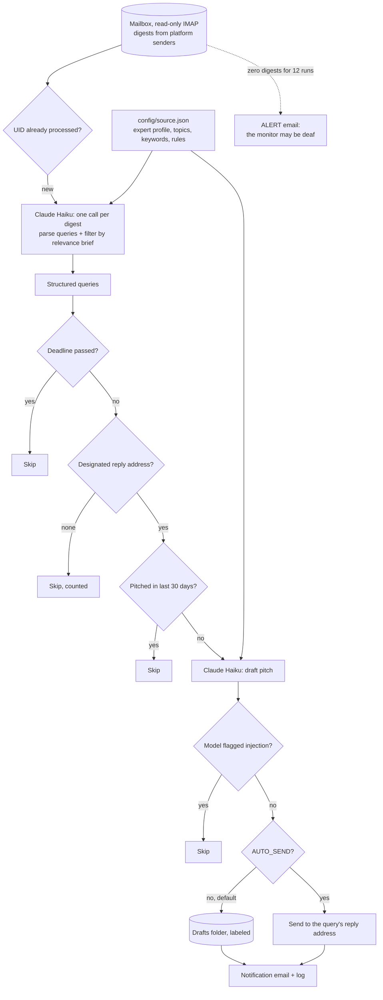

# Journalist Request Monitor: read every reporter query, answer only the ones you can credibly answer

A job that runs four times a day against the mailbox where journalist-request digests arrive (HARO, Source of Sources, Qwoted). Claude reads each digest, pulls out the few queries a named expert can genuinely speak to, and drafts a pitch for each one. Drafts wait in the mailbox for review, or go out automatically if that is switched on.

## The problem

Journalist-request services send several digests a day, each with dozens of queries. One or two a week are relevant. Reporters work to deadlines measured in hours, so a relevant query found the next morning is already gone. Reading every digest by hand is not sustainable, and missing them means never being quoted.

Automating this has three ways to go wrong, and each is handled explicitly:

- **Answering the wrong person.** A digest contains many reply addresses. Sending a pitch to an address that belongs to a different query is worse than not pitching at all.
- **Silence that looks like success.** If a mail filter changes and digests stop reaching the folder the job reads, every run reports "nothing new" forever.
- **Untrusted input.** Query text is written by strangers and passed to a model. Some of it is written to steer AI assistants.

## What it does

`src/monitor.js` on every run:

1. **Reads** the last three days of digests from the known platform senders, over IMAP in read-only mode. Messages already processed are skipped by UID.
2. **Parses and filters in one model call per digest.** Claude returns structured queries (outlet, journalist, reply address, deadline, topic, full text) and keeps only those that match the expert's relevance brief.
3. **Drops** queries whose deadline has passed, queries with no designated reply address, and queries pitched in the last 30 days.
4. **Drafts** a 150 to 250 word pitch per remaining query, in the expert's voice, from the profile in `config/source.json`.
5. **Saves** each pitch to the mailbox's Drafts folder with a label, or sends it when `AUTO_SEND=true`. At most `PITCH_LIMIT` per run.
6. **Reports** by email what was drafted or sent, and logs per-run diagnostics.

## Architecture



## Key design decisions

**Parsing and relevance happen in one call.** Each digest goes to the model once and comes back as JSON containing only the relevant queries, plus a count of all queries seen. That keeps cost at one call per digest no matter how many queries it holds.

**A reply address is used only if it belongs to that query.** The prompt spells out how each platform assigns addresses and requires `null` when no address is explicitly tied to the query. It forbids guessing, reusing an address from another query, or taking one from the email header or footer. A query with `null` is skipped and counted.

**Query text is treated as untrusted input.** Both prompts mark the digest as data and tell the model never to follow instructions inside it. The parser is told to exclude any query that contains embedded instructions, and the drafter returns a fixed skip marker instead of a pitch if it sees one.

**The monitor knows when it has gone deaf.** Every run records how many platform emails it saw. After 12 consecutive runs with none, it sends an alert that lists what to check, instead of logging another clean run.

**The mailbox is never modified while reading.** Digests are read in read-only mode and tracked by UID in the job's own log, so the owner's read and unread state is untouched and nothing depends on it.

**Deadlines and cooldowns are enforced in code.** A query past its deadline (with a one-hour grace) is skipped, and the same query cannot be pitched twice within 30 days.

**Review is the default.** Pitches are saved as labeled drafts for a person to read and send. Automatic sending is an explicit opt-in.

**The expert profile is config.** Who the source is, what they can credibly speak to, the keyword lists and the hard content rules live in `config/source.json`. The pitch prompt may not go beyond that context.

## Results

From the production log, October 18 to November 9, 2026:

- **90** runs read **59** digests.
- **2** queries passed every gate and were pitched.

The numbers are small on purpose. The job's value is reading everything and staying quiet unless a query is a real fit.

## Repository layout

```
src/monitor.js             IMAP reading, digest parsing, gates, pitch drafting, drafts or send, alerts
src/config.js              env + config/source.json loader
config/source.example.json expert profile, relevance topics and keywords, content rules
scripts/test-helpers.js    offline tests for the deterministic helpers
.github/workflows/         four runs a day, state carried in the Actions cache
```

## Setup

Requires Node 20+, a Gmail mailbox with an app password that receives the digests, and an Anthropic API key.

```bash
npm install
npm test                                          # offline, no keys needed
cp .env.example .env                              # fill in values
cp config/source.example.json config/source.json  # the expert's profile and rules
npm run dry-run                                   # shows matches and pitches, saves nothing
npm run monitor                                   # saves drafts for review
```

| Variable | Purpose |
|---|---|
| `GMAIL_USER`, `GMAIL_APP_PASSWORD` | Reading digests, saving drafts, sending notifications |
| `ANTHROPIC_API_KEY`, `CLAUDE_MODEL` | Digest parsing and pitch drafting |
| `AUTO_SEND` | `true` sends pitches instead of saving drafts. Default off |
| `PITCH_LIMIT` | Maximum pitches per run. Default 5 |
| `HARO_MAILBOX` | Folder searched for digests. Default `[Gmail]/All Mail` |
| `REPLY_TO`, `CONFIG_DIR`, `STATE_DIR` | Optional overrides |

Check each platform's rules on AI-assisted responses before turning on `AUTO_SEND`. Reviewing drafts keeps a person accountable for what is sent.

Scheduled runs are off by default. Set the repository variable `ENABLE_SCHEDULE` to `true` to turn the schedule on; manual runs from the Actions tab always work.

---

Extracted from a production automation suite I built and ran for a live e-commerce and B2B wholesale business, 2026.

© Michael Wootan. Source shared for portfolio review; all rights reserved.
